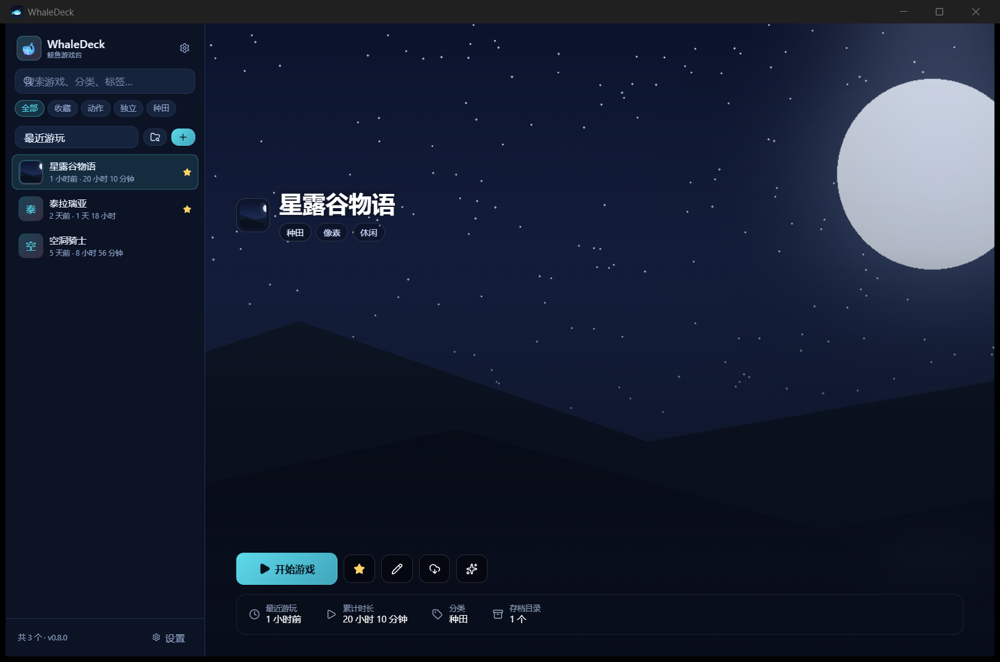

# WhaleDeck 🐋

> 本地游戏 / 项目启动台 —— 把散落各处的东西收进一个界面，点一下就打开，游戏还会自动记录游玩时长。

WhaleDeck 是一个 Windows 桌面应用（Tauri 2 + React 19 + TypeScript）：不联网、不上传、不碰你的文件和存档（备份除外，那是你自己点的）。



## 功能

- **什么都能加入**：游戏 exe、快捷方式、bat/cmd、文档、图片、文件夹……任意路径都可以。
  - exe / bat / cmd：以进程方式启动，自动计时与进程监控。
  - 其他文件与文件夹：用系统默认程序打开，只记录「最近打开」。
- **一键打开**：双击卡片或点「启动 / 打开」，正确传递工作目录与启动参数。
- **自动计时**：后台每 2 秒采样进程，游戏退出后自动结算并累计时长；支持「额外进程名」应对启动器拉起的游戏。
- **文件夹扫描**：选一个装着游戏的文件夹，递归找出里面的 exe，勾选后批量加入（自动跳过已在库中的）。
- **存档备份**：给每个游戏配置一到多个存档目录，一键打包成 zip；存档坏了可以还原回去。
- **可靠存储**：数据存本机 JSON，原子写入 + 保留 5 份备份，损坏自动回退；异常退出用 `pending_session.json` 补算时长。
- **封面**：本地图片复制进数据目录，无封面时用渐变色首字母占位。
- **外观自定义**：4 套预设主题（默认鲸鱼娘配色）、自定义主色/强调色、自定义背景图与遮罩强度、深色/浅色/跟随系统。
- **备份迁移**：导出/导入整个库（含封面文件夹）。

## 界面

- 左侧：全部 / 收藏 / 分类 / 已隐藏 / 设置
- 顶部：搜索、排序、扫描、添加
- 主区：自适应卡片网格
- 右侧：详情抽屉（启动、编辑、修正时长、存档备份、移除）

## 安装与排障

- 安装包：`WhaleDeck_0.2.0_x64-setup.exe`（NSIS，按当前用户安装，无需管理员权限）。
- 免安装：`release/WhaleDeck-0.2.0-portable.zip`，解压双击 `WhaleDeck.exe` 即可。

**安装时提示「无法打开写入文件」？**

安装程序会记住上一次选择的安装目录。如果之前选过一个没有写权限的目录（例如 `D:\xin\`），再次安装就会往那里写并失败。处理方式：

1. 删除旧安装记录：
   ```powershell
   Remove-Item "HKCU:\Software\Microsoft\Windows\CurrentVersion\Uninstall\WhaleDeck" -Recurse
   ```
2. 重新运行安装包，在「安装位置」一步保持默认（`%LOCALAPPDATA%\WhaleDeck`）或改成自己有写权限的目录。

不想折腾的话直接用上面的便携版。

## 开发

前置要求：Node.js 20+、pnpm、Rust（MSVC 工具链）、WebView2（Windows 10/11 自带）。

```bash
pnpm install          # 安装前端依赖
pnpm tauri dev        # 开发模式（Vite + Tauri 热更新）
pnpm build            # 只构建前端
pnpm test             # 前端测试（Vitest）
cd src-tauri && cargo test   # Rust 测试
pnpm tauri build      # 打包安装程序（NSIS）
```

## 数据位置

```
%APPDATA%\com.whaledeck.app\
├─ data\games.json
├─ data\settings.json
├─ data\backup\        # 最近 5 份自动备份
├─ covers\             # 封面
├─ backgrounds\        # 背景图
└─ backups\<游戏 id>\  # 存档备份 zip
```

## 项目结构

```
src/                     React 前端（组件 / 状态 / 工具）
src-tauri/src/           Rust 后端（命令 / 存储 / 启动器 / 存档备份）
docs/设计方案.md          设计基线与约定
scripts/make_icon.py     生成应用图标源图
```

## 设计文档

需求、数据模型、IPC 接口、里程碑都在 [docs/设计方案.md](docs/设计方案.md)。**改需求先改文档，再改代码。**

## 许可

MIT
